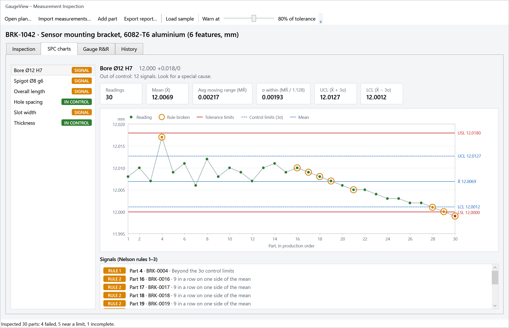
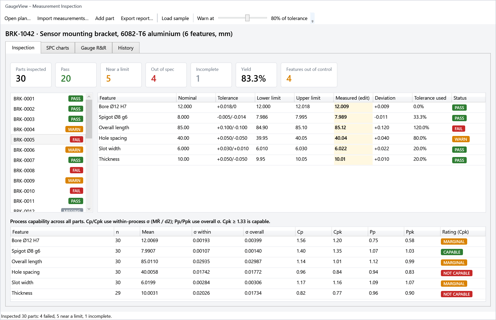
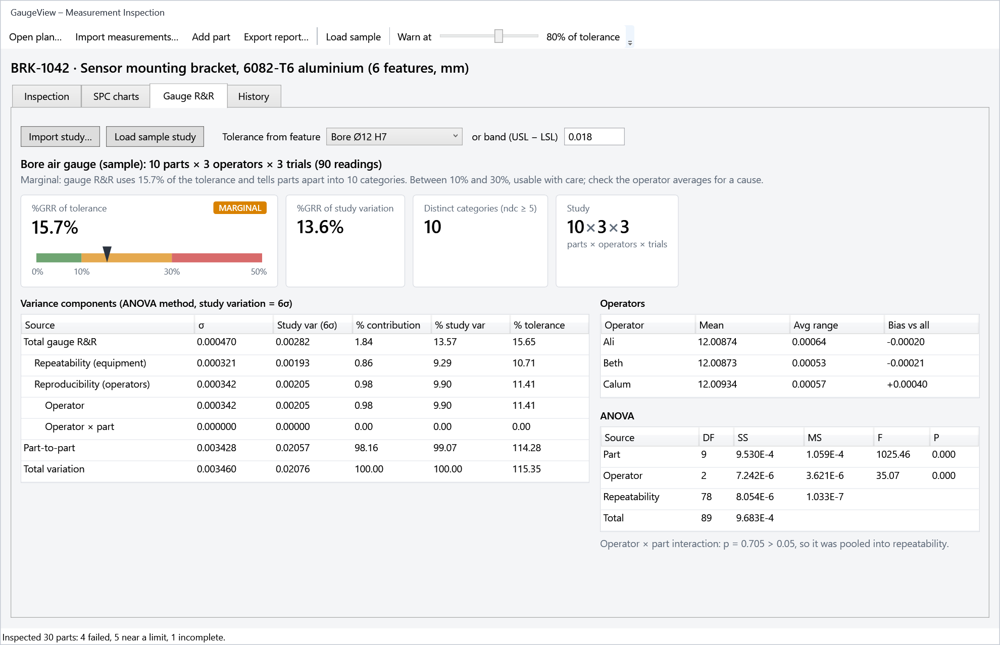
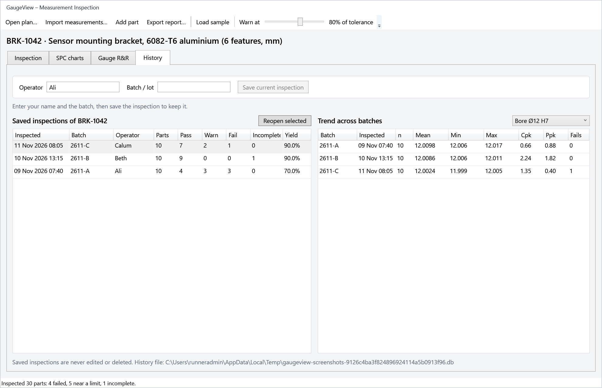

# GaugeView

**Measurement inspection for machined parts.** GaugeView checks each measured feature against its drawing
tolerance, flags anything out of spec, and uses SPC control charts to catch a process drifting towards a limit
before it starts making scrap. It is a C# / .NET 10 WPF desktop app, built with MVVM and unit-tested with xUnit.

[](https://github.com/22ishaq/GaugeView/actions/workflows/ci.yml)
[](https://github.com/22ishaq/GaugeView/releases/latest)




```
inspection plan (JSON) ──┐
                         ├─▶ Inspector ─▶ ToleranceChecker ─▶ PASS · WARN · FAIL · MISSING ─▶ WPF grid ─▶ CSV report
CMM / gauge CSV ─────────┘                                          │
                                                                    ├─▶ Cp · Cpk · Pp · Ppk per feature
                                                                    └─▶ individuals control chart + Nelson rules
```

> **Status: v1.0.** Inspection, SPC, capability, gauge R&R, history and the installer are done and tested.
> [Download it](https://github.com/22ishaq/GaugeView/releases/latest); the next sprint is on the
> [GitHub backlog](https://github.com/22ishaq/GaugeView/milestone/3).

## What it does

- **Checks readings against ISO 286 tolerances.** Deviations are signed, so a 12 mm H7 bore (+0.018/0) and an
  8 mm g6 spigot (−0.005/−0.014, with both limits below nominal) are entered exactly as they appear on the drawing.
- **Shows a traffic-light status for each feature.** Green when comfortably in tolerance, amber once a reading uses
  80% or more of its tolerance (adjustable with a slider), red when out of spec, and grey when not yet measured.
  A part takes the worst status of its features.
- **Plots an SPC control chart for each feature.** Readings in production order against the 3σ control limits and
  the tolerance limits, with Nelson rules 1–3 flagging points beyond the limits, runs of nine on one side of the
  mean, and six in a row rising or falling. Hover over a point to see its part and the rule it broke.
- **Calculates process capability.** Cp and Cpk from the within-process σ, and Pp and Ppk from the overall σ,
  rated against the usual Cpk ≥ 1.33 target. A large gap between Cpk and Ppk means the process is moving.
- **Runs gauge R&R studies.** Import repeated readings by several operators and GaugeView works out repeatability
  and reproducibility by ANOVA, reported as %GRR of the feature's tolerance against the usual 10% / 30% bands,
  with the number of distinct categories and each operator's bias.
- **Keeps an inspection history.** Save each inspection with the operator, batch and time to a local SQLite file,
  reopen any of them exactly as it was, and follow a feature's mean, range, Cpk, Ppk and fails from batch to batch.
- **Accepts manual entry.** Type a reading straight into the grid and the feature, the part verdict, the summary
  and the capability figures all update at once. Text that isn't a number is flagged instead of crashing the app.
- **Imports and exports files.** Load an inspection plan (JSON) and readings exported from a CMM or gauge (CSV).
  Export a per-feature report (CSV) that opens cleanly in Excel.

## Screenshots

| Inspection | Gauge R&R | History |
|---|---|---|
| [](docs/screenshots/inspection.png) | [](docs/screenshots/gauge-rr.png) | [](docs/screenshots/history.png) |
| BRK-0005 has an amber and a red feature; summary cards and capability across all 30 parts. | The sample bore gauge: marginal at 15.7% of tolerance, with Calum reading high. | Three saved batches. The bore's mean falls batch by batch, and Ppk drops to 0.40 while Cpk still looks fine. |

The images are rendered by the app itself (`GaugeView.exe --screenshots <folder>`) on a Windows runner in CI, so
they always match the code.

## Download

Get the latest build from [Releases](https://github.com/22ishaq/GaugeView/releases/latest). Both downloads are
self-contained, so the PC doesn't need .NET installed.

- **Portable zip:** unzip anywhere and run `GaugeView.exe`.
- **MSIX installer:** installs to the Start menu and uninstalls cleanly from Settings. The package is signed with a
  self-signed certificate created by the release workflow, so trust it once first: open `GaugeView.cer` →
  *Install Certificate* → *Local Machine* → **Trusted People**, then double-click the `.msix`.

Releases are built by [`release.yml`](.github/workflows/release.yml) when a `v*` tag is pushed: it runs the tests,
publishes a self-contained win-x64 build, packs it with `makeappx`, signs it with `signtool`, and attaches the MSIX,
the certificate and the portable zip to the release.

## How a reading is judged

| Status | Rule |
|---|---|
| **FAIL** | Outside the limits. Limits are inclusive, so a reading exactly on a limit is in spec. |
| **WARN** | In spec, but uses 80% or more of the tolerance (configurable from 50% to 100%). |
| **PASS** | In spec and below the warning threshold. |
| **MISSING** | No reading yet. The part can't pass until every feature is measured. |

*Tolerance used* is measured from the **centre of the tolerance zone**, not from nominal. That matters for
one-sided tolerances: a 12 H7 bore's zone is 12.000 to 12.018, so its centre is 12.009, and a reading of exactly
12.000 (the nominal) already uses 100% of the tolerance.

## How drift is caught

Each control chart is an **individuals (X) chart**. Its σ is estimated from the average moving range between
consecutive parts, σ = MR̄ / d2 with d2 = 1.128, not from the overall standard deviation. That is deliberate:
if a tool is wearing, the overall σ grows with the drift and widens the limits until the drift hides inside them,
while the moving range only sees part-to-part noise. The same within σ gives Cp and Cpk; the overall σ gives
Pp and Ppk.

| Rule | Signal | Usually means |
|---|---|---|
| 1 | One reading more than 3σ from the mean | A one-off special cause: a bad clamp, a chip, a misread |
| 2 | Nine in a row on the same side of the mean | The process has shifted |
| 3 | Six in a row all rising or all falling | The process is drifting, as with tool wear |

Control limits describe what the process does; tolerance limits describe what the drawing allows. A process can
be in control and still make scrap, or out of control while every part still passes.

## Gauge R&R

Before trusting a reading you need to know how much of it is the gauge. A crossed study has every operator
measure every part several times; GaugeView analyses it by two-way ANOVA (parts × operators, with repeats), as in
the AIAG MSA manual:

- **Repeatability** (equipment variation) is the spread when one operator re-measures the same part.
- **Reproducibility** (appraiser variation) is the spread between operators, including any operator × part
  interaction. The interaction is tested first; if its p-value is above 0.05 it is pooled into repeatability.
- **%GRR of tolerance** = 6σ(gauge) ÷ (USL − LSL). Under 10% is acceptable, 10–30% may be acceptable, over 30% is not.
- **ndc** (number of distinct categories) = 1.41 × σ(part) ÷ σ(gauge), rounded down. Five or more is the usual minimum.

p-values come from an F distribution implemented in Core (regularized incomplete beta), so the library has no
maths dependency. The tests compare every figure with NumPy and `scipy.stats`.

The sample study (`samples/bore-gauge-study.csv`) is ten bores measured three times each by three operators.
The air gauge comes out **marginal at 15.7% of the 0.018 mm tolerance**, with ndc = 10. The operator table shows
why: Calum reads about 0.6 µm higher than Ali and Beth, so retraining or a better locating fixture is the next step.

## Inspection history

Inspections are saved to `%LOCALAPPDATA%\GaugeView\history.db`, one SQLite file the user can back up or copy.
(When installed from the MSIX, Windows redirects this into the package's own app-data folder.)

- **Records are only ever added.** An inspection is evidence of what was measured, so GaugeView never edits or
  deletes one. Reopening an inspection restores its plan, readings and warning threshold exactly.
- **Exact values.** Readings and tolerances are stored as invariant-culture text, not SQLite `REAL`, so 12.010 comes
  back as 12.010. Times are stored as UTC ISO 8601, which also sorts correctly as text.
- **Safe SQL.** Every value is a bound parameter, each save is a single transaction, and foreign keys are enforced.
- **Versioned schema.** The schema version lives in `PRAGMA user_version`. Older files are upgraded in place by
  numbered migrations; a file from a newer GaugeView is refused rather than modified.
- **Trends across batches.** For any feature, one row per saved batch: n, mean, min, max, Cpk, Ppk and fails,
  oldest first.

### Why `decimal`, not `double`

In binary floating point, `0.7 + 0.1` is `0.7999999999999999`, so a part measured exactly on a 0.8 mm limit
would be failed. GaugeView does all tolerance arithmetic in `decimal`, where limits are exact, and only switches
to `double` for the statistics. A unit test covers this case.

## Architecture

```
src/
  GaugeView.Core           tolerances, capability, SPC, gauge R&R, CSV/JSON I/O          net10.0
  GaugeView.Data           SQLite inspection history (Microsoft.Data.Sqlite)             net10.0
  GaugeView.Presentation   view models, commands, dialog abstraction (no WPF reference)  net10.0
  GaugeView.Wpf            XAML views, converters, Windows dialogs                       net10.0-windows
tests/
  GaugeView.Core.Tests           tolerances, checker, capability, SPC rules, gauge R&R, file formats
  GaugeView.Data.Tests           SQLite round trips, schema versioning, trends (real SQLite files)
  GaugeView.Presentation.Tests   view model behaviour, commands, editing, export, history
```

- **MVVM with a strict split.** The view models live in their own project with no reference to WPF. Everything
  except the XAML is unit-tested, and the tests run on Linux in CI as well as on Windows.
- **Core has no dependencies.** It defines `IInspectionHistory`; `GaugeView.Data` implements it with SQLite, and
  the view models only see the interface, so their tests use an in-memory fake.
- **No logic in code-behind.** `MainWindow.xaml.cs` only calls `InitializeComponent()`. `App.xaml.cs` is the
  composition root that gives the view model real Windows dialogs; the tests use a fake `IDialogService`.
- **Warnings are errors** across the solution, with nullable reference types on. Package versions are managed
  centrally in `Directory.Packages.props`.

## Building from source

You need the [.NET 10 SDK](https://dotnet.microsoft.com/download). The app runs on Windows; the libraries and
tests build and run on any OS.

```bash
git clone https://github.com/22ishaq/GaugeView.git
cd GaugeView
dotnet run --project src/GaugeView.Wpf   # Windows only: opens with the sample data loaded
dotnet test                              # any OS: runs the 140 tests
```

CI builds and tests every push on Ubuntu and Windows (warnings are errors, including NuGet vulnerability audits),
then publishes the Windows app as a workflow artifact. A second workflow renders the screenshots.

## File formats

**Inspection plan** (`samples/bracket-plan.json`). Upper and lower deviations are signed:

```json
{
  "partNumber": "BRK-1042",
  "description": "Sensor mounting bracket, 6082-T6 aluminium",
  "unit": "mm",
  "features": [
    { "name": "Bore Ø12 H7",  "nominal": 12.000, "upper": 0.018,  "lower": 0.000 },
    { "name": "Spigot Ø8 g6", "nominal": 8.000,  "upper": -0.005, "lower": -0.014 }
  ]
}
```

**Measurements** (`samples/bracket-measurements.csv`). One reading per row, with columns in any order and `#` for
comments. Numbers always use a full stop, whatever the PC's regional settings:

```csv
serial,feature,value
BRK-0001,Bore Ø12 H7,12.008
BRK-0001,Spigot Ø8 g6,7.991
```

If a part is measured twice, the later reading counts.

**Gauge study** (`samples/bore-gauge-study.csv`). One reading per row; repeat readings of a part by the same
operator are the trials, so a `trial` column is optional. Every operator must measure every part equally often:

```csv
part,operator,trial,value
1,Ali,1,12.0043
1,Beth,1,12.0045
```

## Sample data

The sample is thirty brackets with six features each, measured in production order. With the default 80% warning
threshold they come out as **20 pass, 5 warn, 4 fail and 1 incomplete**. The mix covers every status: readings near
a limit and exactly on one (amber), features outside their limits by as little as 1 µm, and one part still waiting
for its thickness reading.

From BRK-0016 the boring tool starts to wear and the Ø12 H7 bore creeps towards its lower limit. Every bore still
passes until BRK-0030, but the SPC chart flags the drift at **BRK-0021** (six readings in a row falling), nine
parts earlier. The bore's Cpk is 1.20 while its Ppk is 0.58, which is the same story in numbers. Tests check these
figures, so this README can't drift from the code.

## How the work is planned

Work is planned in short sprints on the [GitHub backlog](https://github.com/22ishaq/GaugeView/issues), one
[milestone](https://github.com/22ishaq/GaugeView/milestones) per sprint. Each issue is built on its own branch and
merged through a pull request once CI is green on Ubuntu and Windows.

| Sprint | Delivered |
|---|---|
| 1: MVP | Tolerance model, pass/warn/fail, CSV/JSON import, capability, main window, manual entry, CSV export, CI |
| 2: Insight and polish | SPC charts and Nelson rules, Cp/Cpk vs Pp/Ppk, gauge R&R, SQLite history, MSIX installer, screenshots |
| 3: Shop-floor integration (next) | Moving range chart, configurable rules, QIF import from a CMM, PDF certificate, keyboard-only entry |

## License

[MIT](LICENSE)
